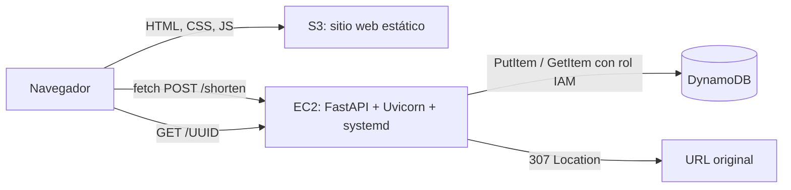

# Nexo · Acortador de enlaces en AWS

Aplicación académica con **HTML, CSS y JavaScript en S3**, **FastAPI en EC2** y **DynamoDB**. El UUID completo se genera exclusivamente en el backend. Cada acceso al enlace consulta DynamoDB y devuelve una redirección HTTP **307**.

Repositorio: https://github.com/JosueRBorja/acortador-enlaces-aws

> Estado: código e infraestructura preparados para desplegar. Las pruebas locales utilizan Moto para emular DynamoDB; no constituyen evidencia de un despliegue en AWS. Completar la verificación de `docs/ENTREGA.md` después de publicar.

Verificación local: **14 pruebas aprobadas** en Python 3.14.4, revisión estática sin hallazgos, dependencias consistentes, JavaScript con sintaxis válida y plantilla YAML analizada. Se comprobó visualmente la interfaz y su mensaje de API no disponible. La plantilla aún requiere validación y ejecución en CloudFormation. La combinación actual Starlette/httpx emite un aviso de futura deprecación de TestClient, sin fallos en las pruebas.



## Estructura

```text
backend/app/        Configuración, esquemas, repositorio, servicio y API
frontend/           Interfaz sin frameworks ni credenciales AWS
infrastructure/     CloudFormation: red, S3, DynamoDB, IAM y EC2
deploy/             Servicio systemd
scripts/            Verificación integrada contra una API real
tests/              Pruebas de API con DynamoDB emulado
docs/DESPLIEGUE.md  Guía de publicación paso a paso
docs/ENTREGA.md     Lista de evidencias y guion del video
```

## Preparación local (PowerShell)

### Demo sin cuenta AWS

Desde la carpeta del proyecto, con las dependencias de desarrollo instaladas:

```powershell
.\.venv\Scripts\python.exe scripts\run_local.py
```

Abre `http://127.0.0.1:5500`. El comando sirve la interfaz y la API con DynamoDB
emulado por Moto, sin contactar AWS ni requerir claves. Puedes crear, copiar, abrir
y consultar enlaces. Detén ambos servidores con Ctrl+C. **Los datos de esta demo
se pierden al cerrar el proceso**: no sirve para demostrar persistencia real en AWS.
La configuración de la demo se aísla de `.env` y del destino EC2 de `config.js`.
Los puertos 5500 y 8000 deben estar libres.

### Instalación y ejecución con DynamoDB real

Python 3.12 o posterior recomendado; Git y VS Code. Para empezar desde GitHub:

```powershell
git clone https://github.com/JosueRBorja/acortador-enlaces-aws.git
cd acortador-enlaces-aws
code .
python -m venv .venv
.\.venv\Scripts\Activate.ps1
python -m pip install -r requirements.lock.txt -r requirements-dev.txt
Copy-Item .env.example .env
python -m pytest -q
```

Si PowerShell bloquea la activación, usa directamente `.\.venv\Scripts\python.exe` para todos los comandos Python, sin modificar la política de ejecución del equipo. El archivo `requirements.lock.txt` fija las dependencias de ejecución; `requirements.txt` expresa sus rangos permitidos.

Las pruebas no requieren cuenta AWS y nunca usan credenciales reales. Para ejecutar la API contra DynamoDB real desde tu equipo, configura primero un perfil de AWS CLI/SSO autorizado con GetItem/PutItem sobre tu tabla; no pongas claves en `.env`. Ajusta `DYNAMODB_TABLE`, `AWS_REGION`, `PUBLIC_BASE_URL` y `CORS_ORIGINS` en `.env`.

```powershell
python -m uvicorn backend.app.main:app --host 127.0.0.1 --port 8000 --reload
```

En otra terminal sirve la interfaz por HTTP:

```powershell
.\.venv\Scripts\python.exe -m http.server 5500 --bind 127.0.0.1 --directory frontend
```

Abre `http://127.0.0.1:5500` y la documentación interactiva `http://127.0.0.1:8000/docs`. No abras `index.html` mediante `file://`. La API normal utiliza DynamoDB sin alternativa automática en memoria; la demo emulada solo se activa ejecutando explícitamente `scripts/run_local.py`.

## Contrato de API

| Método y ruta | Resultado |
| --- | --- |
| `POST /shorten` | 201 con UUID v4, URL original, enlace generado y fecha UTC |
| `GET /{short_code}` | 307 y cabecera `Location` hacia la URL original |
| `GET /urls/{short_code}` | 200 con UUID, URL original y fecha UTC |
| `GET /health` | 200 si el proceso responde; no comprueba DynamoDB |

Ejemplo de cuerpo: `{"original_url":"https://www.example.com/articulos/arquitectura-cloud"}`.

Un UUID inexistente o mal formado devuelve 404; una URL inválida devuelve 422; un fallo conocido del SDK de AWS devuelve 503 sin detalles internos. Solo se aceptan HTTP/HTTPS sin credenciales embebidas, hasta el límite de 2083 caracteres del tipo `HttpUrl`. Las URLs pueden contener información sensible: no se registran en logs de acceso y no se deben compartir destinos privados.

## Decisiones de implementación

- Separación de API, validación, lógica y persistencia; dependencias inyectables y cierre del cliente Boto3.
- Operaciones síncronas de Boto3 en endpoints `def`, ejecutados por FastAPI en su grupo de hilos.
- UUID v4 completo, escritura condicional que evita sobrescritura y lectura consistente después de crear.
- Fechas ISO 8601 en UTC. DynamoDB solo declara `short_code` como atributo clave; los otros atributos se incluyen al escribir cada elemento.
- Configuración mediante entorno; rol IAM de EC2 limitado a `GetItem` y `PutItem` en la tabla concreta; IMDSv2 obligatorio.
- CORS con el origen exacto del frontend, sin comodines. CORS no es autenticación: esta API es pública según la práctica.
- Interfaz accesible y adaptable, mensajes de error, espera máxima y copiado con alternativa para HTTP. Datos de la API insertados con `textContent`.
- systemd reinicia el proceso si falla y lo arranca con la instancia, con usuario sin privilegios y archivos de aplicación de solo lectura.

El UUID completo cumple la consigna, aunque no garantiza que la dirección resultante sea más breve que todos los destinos originales. No se implementan cuentas, analítica ni eliminación de enlaces fuera del alcance solicitado.

## Publicación y entrega

Sigue [la guía de AWS](docs/DESPLIEGUE.md) y [las pruebas y guion de entrega](docs/ENTREGA.md). La plantilla usa HTTP para frontend y backend por simplicidad académica. Para un servicio productivo se requiere HTTPS en ambos extremos, control de abuso y límites de uso; CloudFront con HTTPS no puede consumir una API HTTP desde el navegador.

Fuentes oficiales consultadas:

- [CORS en FastAPI](https://fastapi.tiangolo.com/tutorial/cors/).
- [Endpoints de sitios web S3 y limitación de HTTPS](https://docs.aws.amazon.com/AmazonS3/latest/userguide/WebsiteEndpoints.html).
- [Acciones y recursos IAM de DynamoDB](https://docs.aws.amazon.com/service-authorization/latest/reference/list_dynamodb.html).
