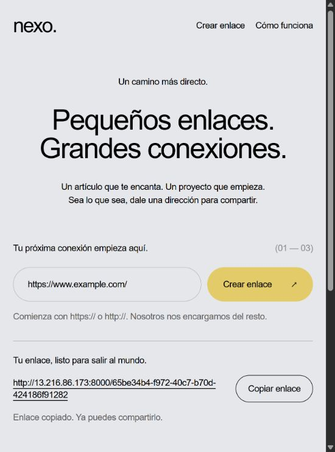

# Despliegue real y evidencias

Verificado el **29 de octubre de 2026**, en la región **us-east-1**.

## Direcciones

| Elemento | Dirección o identificador |
| --- | --- |
| Aplicación S3 | http://nexo-acortador-frontendbucket-fg64zfafebef.s3-website-us-east-1.amazonaws.com/ |
| API y documentación | http://13.216.86.173:8000/docs |
| Información de un enlace | http://13.216.86.173:8000/urls/5d12b480-cf5c-47c9-bee3-ab1a45f35f63 |
| Enlace de prueba | http://13.216.86.173:8000/5d12b480-cf5c-47c9-bee3-ab1a45f35f63 |
| Stack de CloudFormation | nexo-acortador |
| Instancia EC2 | i-0402daa9b972f40ac |
| Bucket S3 | nexo-acortador-frontendbucket-fg64zfafebef |
| Tabla DynamoDB | nexo-acortador-LinksTable-TUGV9EVN6K2C |

## Comprobaciones realizadas

| Comprobación | Resultado |
| --- | --- |
| cfn-lint 1.59.0 sobre la plantilla | 0 errores y 0 advertencias |
| CloudFormation Guard 3.2.1 | 6 reglas de la práctica aprobadas |
| Validación y plan de CloudFormation | Aprobados; 16 recursos nuevos |
| Creación de la pila | CREATE_COMPLETE |
| Tabla y clave de partición | ACTIVE; short_code de tipo String; PAY_PER_REQUEST |
| Archivos de interfaz en S3 | index.html, styles.css, app.js y config.js, en la raíz |
| Configuración del frontend en S3 | API_BASE_URL apunta a la IP elástica de EC2 |
| Inicio de la API | systemd active y enabled, Uvicorn en 0.0.0.0:8000 |
| Credenciales del backend | El registro de Boto3 confirma credenciales del rol IAM de EC2 |
| Rol de EC2 | Solo dynamodb:GetItem y dynamodb:PutItem sobre el ARN de su tabla; sin políticas administradas adjuntas |
| IMDS | HttpTokens required (IMDSv2) |
| SSH | Puerto 22 restringido a la IPv4 del administrador mediante /32 |
| CORS | Preflight y respuesta POST permiten el origen exacto de S3 |
| POST /shorten | 201; UUID v4 generado y enlace público devuelto |
| Persistencia | El elemento fue consultado directamente con DynamoDB GetItem |
| GET /urls/UUID | 200; UUID, URL original y fecha UTC |
| GET /UUID | 307; Location contiene el destino original |
| UUID inexistente | 404 tanto en redirección como en consulta |
| URL inválida | 422 |
| Reinicio real del backend | systemctl restart nexo; el UUID anterior conserva su destino |
| Formulario en navegador desde S3 | Creación y copiado de enlace correctos |
| Navegación real | Abrir el enlace de EC2 lleva automáticamente a https://www.example.com/ |

El copiado se probó desde el endpoint HTTP de S3, incluyendo la alternativa a Clipboard API.
Las excepciones de publicación pública de objetos S3 y acceso al puerto 8000 son intencionales
para la arquitectura de la práctica; no se modificó el bloqueo público global de la cuenta.
Las reglas Guard son controles específicos del proyecto, no una certificación de cumplimiento general.

## Registro de prueba en DynamoDB

```json
{
  "short_code": "5d12b480-cf5c-47c9-bee3-ab1a45f35f63",
  "original_url": "https://www.example.com/",
  "created_at": "2026-10-29T22:15:07.395731Z"
}
```

Se consultó el mismo enlace después de reiniciar el servicio; respondió 307 hacia el mismo destino.
La interfaz S3 generó además el UUID `65be34b4-f972-40c7-b70d-424186f91282`,
que se abrió en el navegador y redirigió al destino original.



## Repetir las verificaciones

Desde PowerShell en la raíz del proyecto:

```powershell
.\.venv\Scripts\python.exe scripts\verify_deployment.py --api-url http://13.216.86.173:8000 --origin http://nexo-acortador-frontendbucket-fg64zfafebef.s3-website-us-east-1.amazonaws.com
```

Para comprobar el enlace ya guardado:

```powershell
.\.venv\Scripts\python.exe scripts\verify_deployment.py --api-url http://13.216.86.173:8000 --origin http://nexo-acortador-frontendbucket-fg64zfafebef.s3-website-us-east-1.amazonaws.com --existing-code 5d12b480-cf5c-47c9-bee3-ab1a45f35f63
```

## Administración y entrega

La clave privada de administración está en `outputs/deployment/nexo-ec2` de la copia local;
esa carpeta está excluida de Git. No subirla ni mostrarla en el video. La clave pública
importada en EC2 se llama `nexo-acortador-admin-20261029`.

```powershell
ssh -i outputs/deployment/nexo-ec2 -o UserKnownHostsFile=outputs/deployment/known_hosts ubuntu@13.216.86.173
```

Dentro de EC2:

```bash
sudo systemctl status nexo --no-pager
sudo journalctl -u nexo -n 30 --no-pager
sudo systemctl restart nexo
```

El backend se instaló desde la rama main, revisión `02cc1e1`. La configuración publicada
de S3 se generó en `outputs/deployment/config.js`; la configuración local del frontend
se mantiene apuntando a localhost para las pruebas de desarrollo.

La aplicación usa HTTP, conforme a la alternativa de alojamiento estático S3 permitida
por la consigna. Los recursos permanecen activos y pueden generar cargos; conservarlos
hasta terminar la evaluación y después seguir la limpieza descrita en DESPLIEGUE.md.

La infraestructura, el código y las pruebas están completos. **Falta que el estudiante
grabe y publique el video explicativo**, siguiendo el guion de ENTREGA.md.
